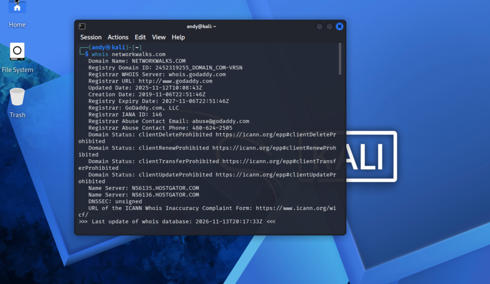
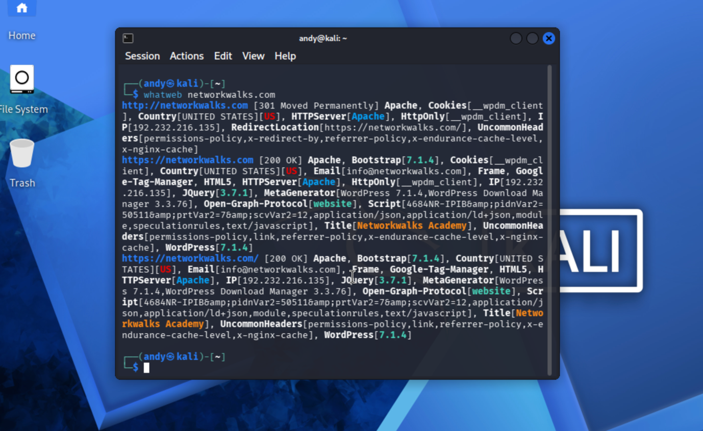
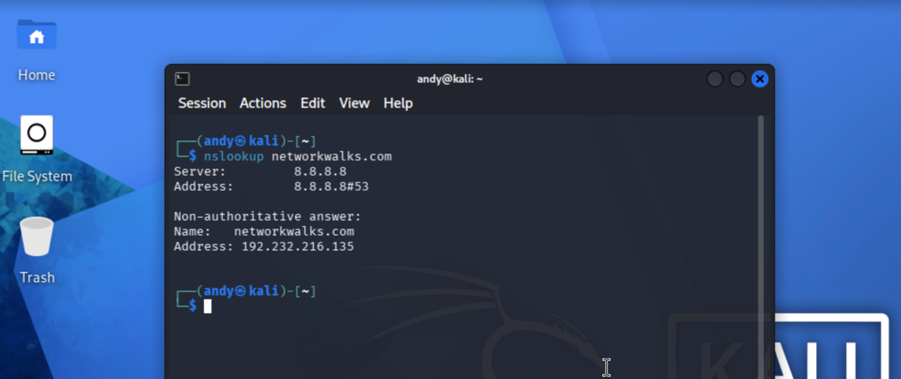
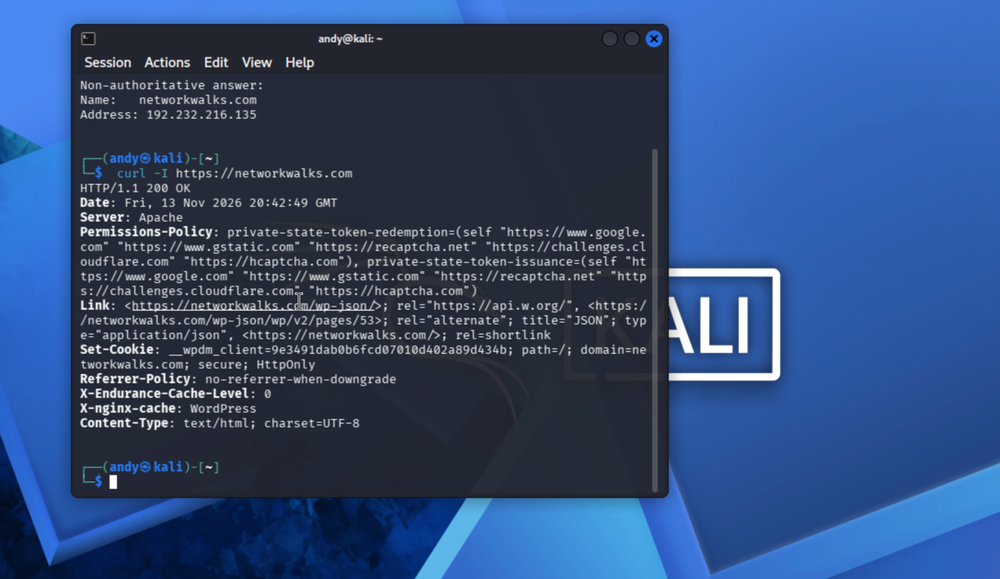
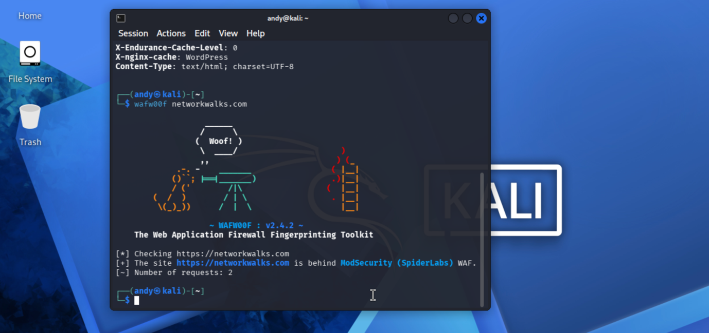
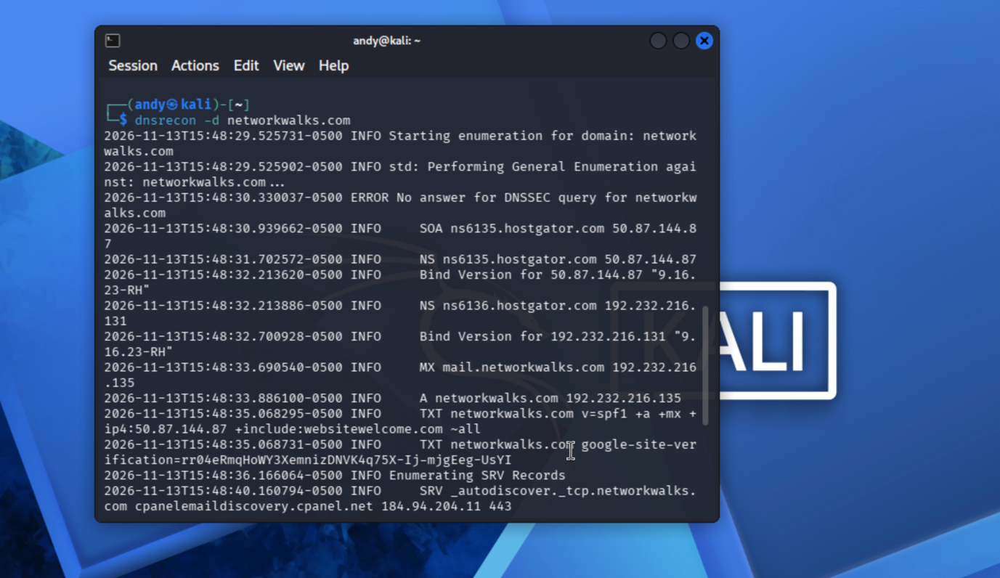
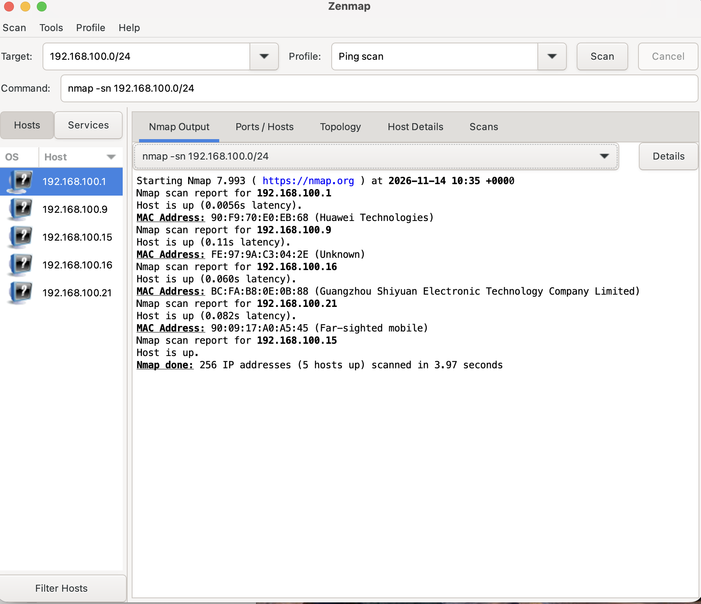
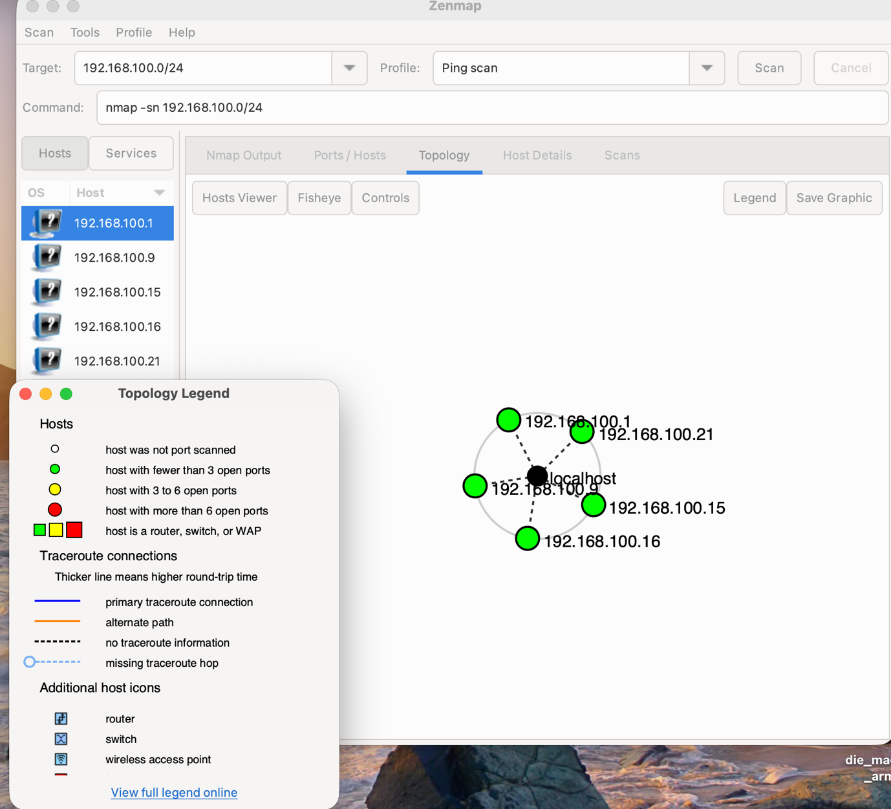

# Penetration Testing Report

**Footprinting & Network Scanning Phases**

W2-PM-FINAL | Cybersecurity | Networkwalks

| Field | Detail |
|---|---|
| Pentester Name (Cybersecurity Professional) | Wright Andy Dela Quarshie |
| Program/Batch | B084-Networkwalks |
| Date | 14 November 2026 |
| Modules completed | W2-PM1 (Multiple Kali Tools), W2-PM5 (Zenmap Scanning) |
| Client/Target | 1. Networkwalks (secured written permission already)   2. My own local LAN network |
| Permission secured from client? | Yes |
| Phases covered | **Phase 1:** Reconnaissance & Footprinting   **Phase 2:** Scanning & Network Discovery |

---

## 1. Liability Disclaimer

I have performed these activities only on the systems & devices where I had secured written permission or the devices/systems that I own myself. All these materials are for education and research purpose only. Do not use anything from here to break the law. The instructor, the authors and Networkwalks are not responsible for what you do with this knowledge. Every action you take is your own responsibility. Misuse can lead to criminal charges, heavy fines, loss of your job and a permanent record. In most countries unauthorised access is a crime even when nothing is damaged.

## 2. Introduction

This report documents the Week 2 practical exercises completed as part of my ongoing internship programme at Networkwalks. It covers two areas of work: domain footprinting using multiple Kali Linux tools (W2-PM1) and local network scanning using Zenmap (W2-PM5).

The first exercise focused on gathering publicly available information about `networkwalks.com`, while the second involved scanning my own local network to identify active hosts. Together, the exercises provided practical experience with two important stages of network reconnaissance: collecting information about a target and identifying devices within a network.

The footprinting exercises were carried out in Kali Linux, while the network scanning exercise was performed on my MacBook using Zenmap. Each section documents the commands and tools used, the results obtained, supporting screenshots, and observations on the security significance of the findings.

## 3. Tools Used

The table below lists each tool used in this report and its purpose.

| Tool | Purpose |
|---|---|
| Kali Linux & macOS | Operating systems used for reconnaissance activities |
| WHOIS | Find domain registration details (owner, dates, name servers). |
| whatweb | Fingerprint web technologies (server, CMS, plugins, IP). |
| nslookup | Resolve the domain name to its IP address using DNS. |
| curl -I | Read the HTTP response headers of the website. |
| wafw00f | Detect whether a Web Application Firewall protects the site. |
| dnsrecon | Enumerate all DNS records (NS, MX, SPF, TXT, SRV). |
| Zenmap (Nmap GUI) | Scan the local subnet to find live hosts, IPs and MAC addresses. |
| macOS Terminal (ifconfig) | Local IP address and subnet identification |

## 4. Activities Performed

### 4.1 Footprinting & Reconnaissance

**Domain Reconnaissance: networkwalks.com**

The reconnaissance exercise involved examining the `networkwalks.com` domain using six tools available in Kali Linux: WHOIS, WhatWeb, Nslookup, Curl, Wafw00f and DNSRecon. Each tool was used to gather a different category of information about the domain and its web infrastructure.

**WHOIS** was used to retrieve publicly available domain registration details, including information about the domain's name servers. This provided an initial view of the domain's registration and hosting information.

**WhatWeb** was then used to identify technologies associated with the website. The results indicated the use of **WordPress 7.1.4** and **WP Download Manager 3.3.76**, alongside other information exposed by the website.

Next, **Nslookup** was used to resolve the domain name to an IP address. The result returned was `192.232.216.135`.

**Curl** was used with the `-I` option to retrieve the website's HTTP response headers. This provided further information about the web server and application. The response also exposed the WordPress REST API endpoint, `/wp-json/`.

After that, **Wafw00f** was used to check whether the website was protected by a Web Application Firewall (WAF). The scan identified **ModSecurity (SpiderLabs)**.

Finally, **DNSRecon** was used to enumerate the domain's DNS records. The results included information about name servers, mail servers, SPF/TXT records, service records and DNS software.

The information collected from these tools provided an overview of the domain's publicly exposed registration details, technologies, IP address, HTTP response information, WAF and DNS configuration. Together, the results demonstrated how different reconnaissance tools can be used to build an initial picture of a website's externally visible infrastructure.

### 4.2 Network Scanning with Zenmap

The second activity involved using Zenmap to perform network discovery on my local network. The practical required me to identify my MacBook's local IP address and subnet, discover active hosts, identify their IP and MAC addresses, and generate a network topology.

I first used the macOS `ifconfig` command in Terminal to check my MacBook's network interface details and identify its local IP address. I then determined the corresponding LAN subnet, `192.168.100.0/24`, and entered it into Zenmap. I selected Ping Scan to identify active hosts on the network.

The scan (`nmap -sn 192.168.100.0/24`) found five live hosts out of 256 addresses, in about four seconds:

| IP address | MAC address | Vendor shown by Nmap |
|---|---|---|
| 192.168.100.1 | 90:F9:70:E0:EB:68 | Huawei Technologies |
| 192.168.100.9 | FE:97:9A:C3:04:2E | Unknown |
| 192.168.100.15 | none shown | My MacBook (Nmap doesn't list a MAC for the machine it runs on) |
| 192.168.100.16 | BC:FA:B8:0E:0B:88 | Guangzhou Shiyuan Electronic Technology Company Limited |
| 192.168.100.21 | 90:09:17:A0:A5:45 | Far-sighted mobile |

After completing the scan, I opened the **Topology** section in Zenmap, enabled the legend and saved the network topology in PDF format as required by the practical task.

## 5. Risk Analysis / Impact

Based on the information collected during the footprinting and network scanning activities, I identified the following potential risks.

| # | Risk / Finding | Evidence / Observation | Potential Impact | Risk Level |
|---|---|---|---|---|
| 1 | Web technology information exposed | WhatWeb identified WordPress and WP Download Manager | Attackers may use exposed technology/version information to identify software requiring further security review | **Medium** |
| 2 | Server IP address identifiable | Nslookup resolved the domain to 192.232.216.135 | Provides information about the network location of the web service | **Low** |
| 3 | HTTP technical information exposed | Curl returned HTTP response headers and exposed /wp-json/ | May assist technology fingerprinting and further enumeration | **Low** |
| 4 | WAF technology identifiable | Wafw00f identified ModSecurity (SpiderLabs) | Reveals information about the web application's security architecture | **Low** |
| 5 | DNS infrastructure information exposed | DNSRecon identified DNS, mail and service-related records | DNS information can help build a broader infrastructure profile | **Medium** |
| 6 | Multiple live hosts visible on local network | Zenmap identified five live hosts on 192.168.100.0/24, one of them with an unknown vendor | Unknown or unauthorized devices may potentially be present on a network | **Medium** |

**Risk level key:** Critical, Medium, Low

The risks above are observations from the footprinting and scanning exercises, not confirmed vulnerabilities.

The practical exercises primarily involved information gathering and host discovery. No exploitation or vulnerability validation was performed as part of these two modules.

Therefore, the presence of information such as a software version, IP address or DNS record does not by itself mean that the system is vulnerable. Further authorized security testing would be required to confirm any actual vulnerability.

## 6. Recommendations

Based on the observations from these activities, I recommend the following security improvements:

- **Review publicly exposed technology information.** Organizations should regularly review what information about their web technologies, CMS and plugins is publicly visible.
- **Keep software updated.** CMS platforms, plugins and other web technologies should be regularly updated and reviewed against current security advisories.
- **Review HTTP headers.** HTTP response headers should be reviewed to determine whether unnecessary technical information is being exposed.
- **Review DNS records regularly.** DNS records should be checked periodically to ensure that only required information and services are publicly exposed.
- **Properly configure and monitor the WAF.** Keep the WAF (ModSecurity) enabled and tuned, since it already blocks naive attacks.
- **Perform regular internal network discovery.** Organizations should periodically scan their own networks to identify active devices.
- **Investigate unknown devices.** Any unexpected device discovered during network scanning should be investigated and verified.
- **Maintain network documentation.** Network topology and device information should be documented and updated regularly.
- **Perform security testing with authorization.** Reconnaissance and scanning should only be performed against systems and networks where appropriate authorization has been provided.

## 7. Conclusion

During Week 2 of my Cybersecurity & Ethical Hacking internship, I completed practical activities covering footprinting, reconnaissance and network scanning.

In the footprinting activity, I used six Kali Linux tools to collect information about the target domain. I learned how WHOIS can provide domain information, WhatWeb can identify web technologies, Nslookup can resolve domain names, Curl can inspect HTTP headers, Wafw00f can identify a WAF, and DNSRecon can provide additional DNS information.

In the network scanning activity, I used Zenmap to identify my local network configuration and discover active hosts. I also collected IP and MAC address information and created a network topology.

The exercises showed me that information gathering is an important part of cybersecurity. Even before attempting to exploit a system, a security professional can learn a significant amount about an environment by carefully analyzing publicly available information and network responses.

I also learned that technical findings should be documented clearly. A good cybersecurity report should explain what was performed, what was discovered, what the observation means, what risk it may create, and what can be done to reduce that risk.

Finally, I learned that reconnaissance and scanning must always be performed within an authorized scope. These activities were completed as part of the assigned educational cybersecurity lab.

## 8. Evidences Collected

Screenshots collected as evidence during the activities (stored in the `screenshots/` folder).

**WHOIS**

**WhatWeb**

**Nslookup**

**Curl (HTTP headers)**

**Wafw00f**

**DNSRecon**

**Zenmap ping scan**

**Zenmap topology**

